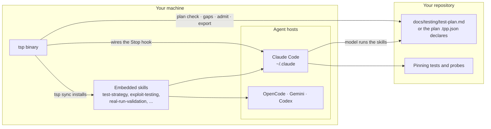
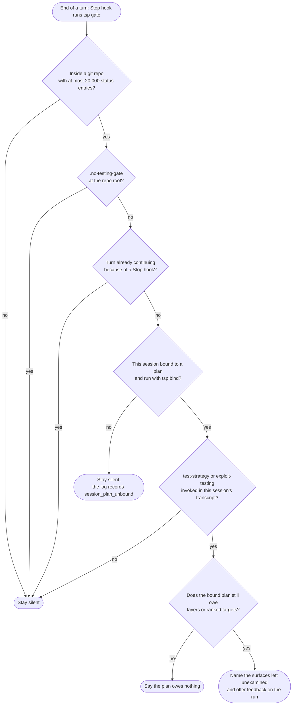
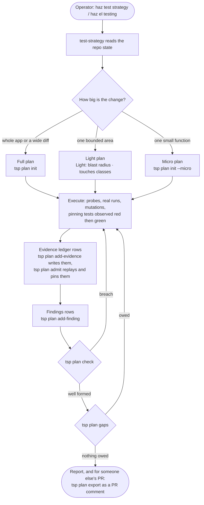
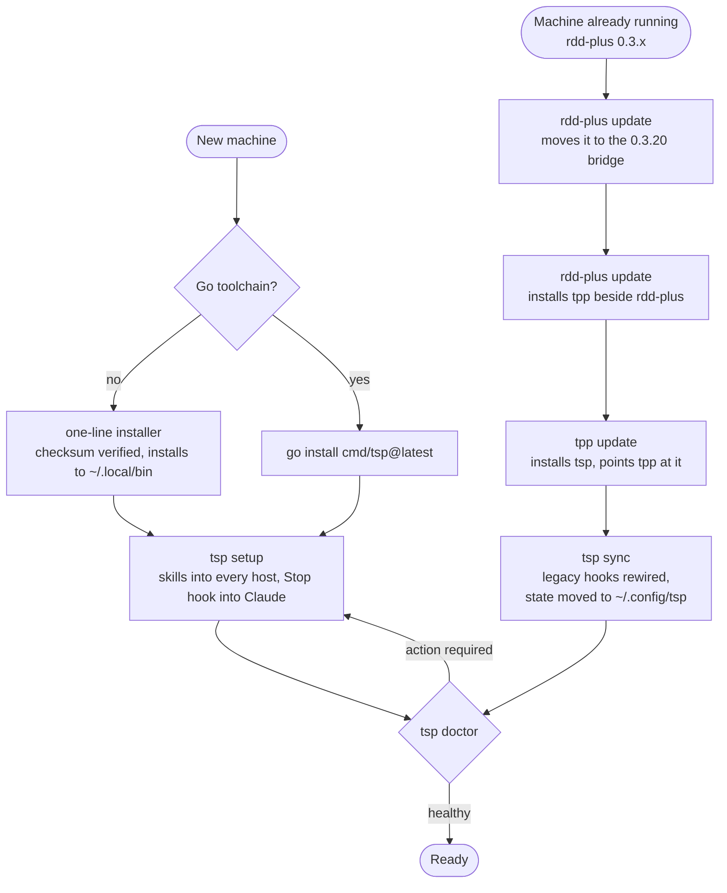
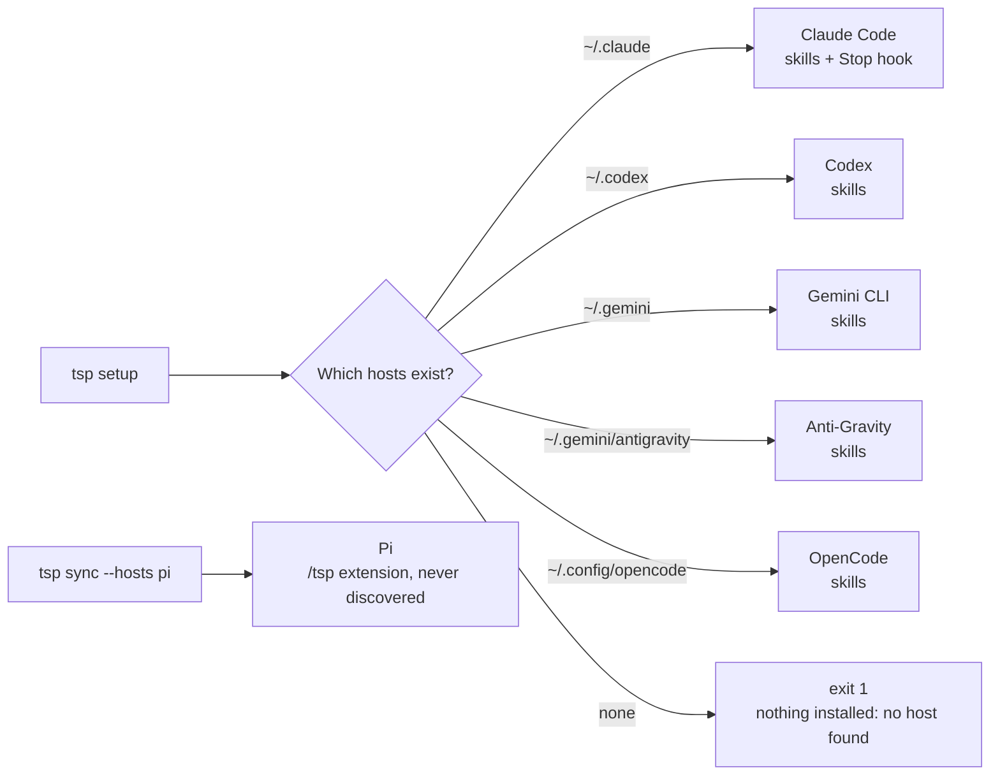

# TSP (Test Strategy Planning)

To install: [paste this prompt into your agent](#install-with-an-agent). It installs tsp, runs the
checks, and reports how it ended — you do not run anything by hand.

A deterministic companion for the testing discipline in Claude Code. It complements gentle-ai; it
does not replace it. gentle-ai owns the review lifecycle (frozen candidate, refuter, receipts).
TSP owns what happens before that: a testing flow the model runs and a set of Go binaries
that keep it honest.

The split is deliberate. The model does the creative work: enumerating the classes of a contract,
imagining the inputs nobody expects, writing the probe. The binaries do the deterministic work:
installing the skills, wiring the hook that keeps them invoked, and reporting what the
environment can do so a skill degrades explicitly instead of failing on a tool it assumed.

For benchmark review/fix/review cycles, use `tsp bench run --sessions N`: independent
sessions keep the agent's tests and apply reference fixes for caught defects between reviews.
See [benchmark sessions](bench/README.md#independent-review-sessions) for records and constraints.

## Install with an agent

Paste one of these prompts into an agent that has a shell. The prompt is short on purpose: `tsp setup`
does the install and the checking itself, so the agent only has to run it, read how it ended, and
report the last line. Every refusal it is told to respect is a real check in the installer.

| You use | Prompt | What you get |
|---|---|---|
| Gentle AI (gentle-ai and engram installed) | [With Gentle AI](#with-gentle-ai) | tsp's testing discipline, plus Gentle AI's native review lifecycle with receipts (RDD) after it, and Engram memory across sessions |
| Neither | [Without Gentle AI](#without-gentle-ai) | tsp's testing discipline on its own. Without gentle-ai there is no native review lifecycle and no receipts; without engram the plan file is the only memory across sessions |
| Pi | [As a Pi extension](#as-a-pi-extension) | The same install, plus Pi's native `/tsp` command |

tsp works the same in all three: the difference is what else is on the machine, not how tsp behaves.

### Without Gentle AI

```text
Set up TSP on this machine and prove it works.

1. Run: curl -fsSL https://raw.githubusercontent.com/alesierraalta/tsp/main/install.sh | sh
   It verifies the release checksum, installs the binary to ~/.local/bin, and runs tsp setup.
2. Report the exit code and the last three lines. It is done only when the exit code is 0 and the last
   line reads "tsp is installed and working: ...".
3. If the shell cannot find tsp afterwards, add the export PATH line the installer printed to the
   profile file it names, then open a new shell.
4. If setup exits 1 with "nothing installed: no host found", stop and tell me: this machine has no
   agent config directory yet, so my agent CLI has to exist first. Then run tsp setup again. Do not
   create a config directory by hand to make the check pass.
5. If the checksum does not match, the system is not Linux, or the architecture has no release
   binary, stop and report which one it was. Do not skip the checksum, pick another version, or use
   sudo.
6. On macOS, or when no Linux binary fits this machine, use Go instead:
   go install github.com/alesierraalta/tsp/cmd/tsp@latest
   "$(go env GOPATH)/bin/tsp" setup
Report every command you ran and how each one ended.
```

### With Gentle AI

```text
Set up TSP on this machine and prove it works.

1. Run: curl -fsSL https://raw.githubusercontent.com/alesierraalta/tsp/main/install.sh | sh
   It verifies the release checksum, installs the binary to ~/.local/bin, and runs tsp setup.
2. Report the exit code and the last three lines. It is done only when the exit code is 0 and the last
   line reads "tsp is installed and working: ...".
3. Gentle AI is already installed here. In the setup output, confirm gentle-ai and engram are listed
   as present, and tell me what the native review lifecycle adds on top of tsp's testing discipline.
4. If setup exits 1 with "nothing installed: no host found", stop and tell me which agent config
   directory is missing, then run tsp setup again once it exists. Do not create it by hand.
5. If the checksum does not match, the system is not Linux, or the architecture has no release
   binary, stop and report which one it was. Do not skip the checksum, pick another version, or use
   sudo.
6. On macOS, or when no Linux binary fits this machine, use Go instead:
   go install github.com/alesierraalta/tsp/cmd/tsp@latest
   "$(go env GOPATH)/bin/tsp" setup
Report every command you ran and how each one ended.
```

### As a Pi extension

Pi is never discovered: `setup` leaves it alone and only `sync --hosts pi` installs it.

```text
Set up TSP on this machine and add its Pi extension.

1. Run: curl -fsSL https://raw.githubusercontent.com/alesierraalta/tsp/main/install.sh | sh
   It verifies the release checksum, installs the binary to ~/.local/bin, and runs tsp setup.
2. Then run: tsp sync --hosts pi
   That installs the extension only; it is the one command that targets Pi.
3. Report the exit code and last lines of both commands, and confirm the file it wrote at
   ~/.pi/agent/extensions/tpp/index.ts.
4. If a command refuses, report its exact message. Do not pass --force, and do not copy files into
   the Pi directories by hand.
Report every command you ran and how each one ended.
```

### Then, in a repository

Setup changes the machine, not a repository. Once it is done, this is what a project needs:

```text
In this repository, run tsp check and tell me what the tests still owe: which changed production
files have no test, and what the plan is missing. Change nothing yet.
```

## Probe undelivered environment settings

Run `tsp probe env [dir]` (default: current directory), or add `--json` for an array
of `{name, read_at, siblings, delivered_by}`. The read-only probe finds uppercase literal
Python, Node and Go environment reads (`os.getenv`, `os.environ`, their `from os import`
forms, `process.env`, `os.Getenv`, `os.LookupEnv`) missing from deployment artifacts when a
setting with the same first underscore-separated token (`APP_` for `APP_MODE`) is deployed;
a lone word such as a Dockerfile `RUN` or a comment's `API` is not a deployed setting. In a source file that
reads the environment (including bare `process.env` or `os.environ` references), all
uppercase string literals containing an underscore also count as reads, covering
settings helpers. Unrelated files retain direct literal-read matching only. Findings include source
`path:line` locations and delivery paths, sorted by setting name.

Deployment artifacts are files under `deploy/`, `infra/`, `k8s/`, `helm/`,
`.github/workflows/`, plus `Dockerfile*`, `docker-compose*`, `*.tf`, `Procfile`,
`.env.example`, `.env.sample`, and `.env.template` at any depth. Tests, dependency
folders, Git internals, virtual environments and directories the probe may not read are
skipped; real `.env` files are never opened. This is a literal-text heuristic, not a proof of runtime delivery.
Exit codes: **1** findings, **0** clean (no text output; JSON prints `[]`), **2** usage
errors (stderr only).

## How it works

Four pictures of the same system: the pieces, the decision the gate takes at every Stop, the testing
flow a model runs, and how an installation stays current. The prose sections below are the
reference; these diagrams only show how the pieces fit.

### The pieces



The model does the creative work (classes of a contract, probes, pinning tests); the binary does the
deterministic work (installing, wiring, checking the plan, replaying evidence).

### What the gate decides at every Stop



Nothing fires from a file's mtime or another chat's worktree: without an explicit `tsp bind` for
this session, the Stop sends no plan notice at all. It is a reminder, never an approval gate: every
path exits 0, and each decision is one line in the telemetry log.

### Plan audits are opt-in, per session

The Stop hook sends no plan notices across chats by default. No working-tree entry, no fresh source
mtime, and no worktree-wide `.tpp.json` declaration proves this session authored a change — so an
unbound stop audits nothing and the log says why (`session_plan_unbound`). Automatic auditing
starts only when this session is bound, from inside the worktree where it runs:

```sh
tsp bind --session <host session ID> --path docs/testing/test-plan.md --run <slug>
tsp bind --unset --session <host session ID>    # remove the record when the session ends
```

| Topic | Decision |
|---|---|
| The record | outside the repository, beside the gate log: a `bindings/` directory at 0700 holding one 0600 file per pair of canonical worktree root and exact session ID, named by a hash — no raw session ID in a filename |
| What the Stop gate reads | only this session's binding, from the environment or that stored file; when both exist they must agree or the gate audits nothing. `.tpp.json`'s `planPath` is never a Stop fallback — it still drives `tsp check` and every `plan *` command, which need no session at all |
| Scope of one record | one exact session in one worktree: two sessions in the same checkout bind independently and each audits its own plan and run; a record never applies to another session or another checkout |
| Stale records | nothing removes a record implicitly; `tsp bind --unset --session <id>` is the housekeeping when a session or worktree retires |
| `TESTING_GATE_LOG` | keep it absolute: `bind` and the Stop hook derive the binding directory from the log path, and a relative path resolves against each process's working directory — bind and Stop would then look in different places and find nothing |
| Concurrent sessions | the binding scopes plan auditing, not source edits: two sessions sharing one working tree still race on files. When the host exposes no session ID, give each chat its own worktree and rely on `tsp check` / `tsp plan gaps` there |
| Base drift | a successful `plan admit --execute` records the checkout's upstream ref and commit beside the gate log (never inside the repository). When the bound audit later finds that ref moved, the Stop emits one `tsp: base drift:` line naming both commits — the model and the operator hear it, because the evidence was validated on the recorded commit, not the tip CI checks out. A dry run, a refused row, a detached HEAD, or a stable ref records nothing and adds nothing |

### The testing flow a model runs



### Installing and staying current



Staying current later is one command, not a reinstall: binary users re-run the one-liner, and Go users
run `tsp update`.

## Install

### Linux (no Go required)

```sh
curl -fsSL https://raw.githubusercontent.com/alesierraalta/tsp/main/install.sh | sh
```

Or with wget:

```sh
wget -qO- https://raw.githubusercontent.com/alesierraalta/tsp/main/install.sh | sh
```

The installer downloads the latest Linux release binary for amd64 or arm64, verifies its SHA-256,
installs it to `~/.local/bin`, prints its version, and runs `tsp setup`. It prints the exact PATH
line to add to `~/.profile` if needed. Downloads require curl or wget, tar, and sha256sum (or shasum).

| Environment variable | Default | Purpose |
|---|---|---|
| `TSP_VERSION` | latest release | Pin a release, for example `v0.6.9` |
| `TSP_INSTALL_DIR` | `~/.local/bin` | Choose the binary directory |
| `TSP_NO_SETUP` | `0` | Set to `1` to skip setup |

When piping to sh, pass variables to sh, for example:

```sh
curl -fsSL https://raw.githubusercontent.com/alesierraalta/tsp/main/install.sh | TSP_VERSION=v0.6.9 sh
```

Requirements: the binary needs git; Python 3/pytest, Node.js, and Cargo are needed only for the
suites they run. Go is required only for the Go installation/update path below. On a minimal image,
install them first, for example `sudo apt-get install -y curl git ca-certificates` (Debian, Ubuntu)
or `sudo apk add curl git` (Alpine).

`tsp setup` installs the skills into the agent hosts it finds (Claude Code at `~/.claude`, Codex at
`~/.codex`, Gemini CLI at `~/.gemini`, Anti-Gravity at `~/.gemini/antigravity`, OpenCode at
`~/.config/opencode`), so install your agent first. A `~/.gemini` that holds only Anti-Gravity's
tree is agy, not the Gemini CLI, and setup does not install a second copy for a host that is not
there. With none of them present setup exits 1 and says so; the binary stays installed, and
running `tsp setup` again after installing the agent finishes the job. Pi is never discovered: Pi
users also run `tsp sync --hosts pi` to install the Pi extension.



Binary users: re-run the Linux one-liner to update. `tsp update` still uses `go install`; without
Go it prints the command to run instead of installing.

### With Go

The module declares Go 1.26; Go 1.21+ toolchains fetch it automatically with `GOTOOLCHAIN=auto`.

```sh
go install github.com/alesierraalta/tsp/cmd/tsp@latest
tsp setup     # sync, then doctor's checks, then one line saying tsp works (exit 0) or what is left
```

If `tsp` is not found, run `"$(go env GOPATH)/bin/tsp" setup` and add the PATH line it prints.

`tsp setup` is the one-step path: it runs the same sync as `tsp sync`, the same checks as `tsp doctor`
against the directory it just wrote, and ends on `tsp is installed and working: <N> skills in <hosts>,
Stop hook wired to <binary>` with exit 0. A failing sync (including a machine with no host yet) stops it
with sync's exit code; a doctor problem ends it on `setup: not finished:` naming that problem, with exit 1.
When the binary's directory is not on `PATH` it prints the exact `export PATH=...` line to add; that is a
warning, not a failure, because the Stop hook calls the absolute path. Run it from the binary you intend
to keep: the hook records the path of the binary that ran it.

### Modes: `setup` and `doctor` share `--mode auto|standalone|gentle`

Run the mode you mean; it is resolved before any work runs, so a mode this build cannot honor stops
at the flag instead of reporting under another contract:

```sh
tsp setup                      # auto: standalone, gentle only with a verified Gentle signal
tsp doctor --mode standalone   # always the standalone contract
tsp doctor --mode gentle       # refused (exit 2, "pending integration") without that signal
tsp doctor --mode turbo        # refused (exit 2) naming auto, standalone, gentle
```

| `--mode` | Runs under |
|---|---|
| `auto` (default) | `gentle` when the verified Gentle signal is active, `standalone` otherwise — so outside the Pi extension `auto` is standalone, even with gentle-ai installed |
| `standalone` | always standalone |
| `gentle` | gentle under that same signal; otherwise refused as `pending integration` (exit 2) |

The only signal `auto` and `gentle` accept is `TSP_GENTLE_OBSERVATION=pi-session-gentle-active`, and
only in the environment of the single `tsp doctor` child the Pi extension spawns (through
`execFile`'s env — no `process.env` mutation, no file), so it is process-scoped. The pre-rename
`TPP_GENTLE_OBSERVATION` is read only while the TSP variable is absent, and an explicit invalid TSP
value fails closed. It is a session UX observation, not authentication or security authority: any
process can set an environment variable, nothing here verifies identity or trust, and it may steer
only which mode this process selects and reports — never anything else.

Step by step, for a person who wants to see each part:

```sh
tmp=$(mktemp -d)
tsp sync --config-dir "$tmp/cfg" --dry-run     # rehearse: the plan, writing nothing
tsp sync --config-dir "$tmp/cfg"               # rehearse into a throwaway Claude directory
tsp doctor --config-dir "$tmp/cfg"             # must exit 0 with verdict: healthy
tsp sync      # installs skills into every discovered host; wires the Stop hook only for Claude
tsp doctor    # verifies the install and lists optional capabilities
```

To prove the hook answers without waiting for a real session, hand the gate the payload its host would.
In a throwaway git repository:

```sh
printf '%s' "{\"session_id\":\"install-check\",\"transcript_path\":\"$tmp/transcript.jsonl\",\"cwd\":\"$tmp/repo\",\"hook_event_name\":\"Stop\",\"stop_hook_active\":false}" \
  | TESTING_GATE_LOG="$tmp/gate.jsonl" tsp gate
```

It exits 0 and leaves one line in `$tmp/gate.jsonl` reading `"skipped":"session_plan_unbound"`: with
no `tsp bind` for that session the gate audits nothing and prints no Stop payload — the answer every
unbound session gets. The gate always exits 0: it grades the turn and never breaks it.

`sync` installs the embedded skills into every host it finds: `~/.claude/skills`,
`~/.config/opencode/skills`, `~/.gemini/skills`, and `~/.codex/skills`. Discovery never offers Pi —
the Pi extension is the explicit `--hosts pi` opt-in described below. The Stop hook is wired only
where its transport is known—Claude Code's `~/.claude/settings.json`; OpenCode, Gemini, Anti-Gravity, and Codex
receive skills but their transports are documented rather than wired. Claude's sync merges into
`~/.claude/settings.json`: every existing hook and setting is preserved, the gate is added once,
and running it again changes nothing. A file modified after tsp installed it is not replaced
by default; pass `--force` to replace it after tsp snapshots the edited file in the central
backup store described below. A path under the skills directory that sync cannot read, or a symlink
back to an enclosing folder, is reported once as a user path and left alone; an unreadable skills
directory itself still aborts the run. An unparseable `settings.json` aborts the run before anything is
written. Use `--config-dir` to target another Claude directory, `--hosts` to narrow installation,
and `--dry-run` to see the plan. Without an explicit `--config-dir`, commands resolve the directory
in this order: `CLAUDE_CONFIG_DIR`, then `PI_CODING_AGENT_DIR`, then `~/.claude`; empty values are
ignored, and a ledger that lives under a different directory is reached with `--config-dir`.

### The Pi extension (opt-in)

The TSP core is shared: the Pi extension is a thin adapter over the same binaries — `/tsp check`,
`/tsp feedback --summary`, and `/tsp doctor` run the CLI documented here. It adds no skills and
duplicates nothing of Gentle's: ODD, Engram memory, and the review lifecycle remain Gentle's
(gentle-ai / gentle-pi), and the extension never calls review authority.

| Command | Behavior |
|---|---|
| `tsp sync --hosts pi` | The explicit opt-in, and the only way Pi is ever installed — discovery never offers it. It installs only the `tpp` extension component at `~/.pi/agent/extensions/tpp/index.ts`, the path Pi loads; a pi-only sync writes no skills and no hook settings. |
| `tsp setup --hosts pi` | Refused as a usage error (exit 2): setup's install and doctor pass are Claude-centered; only `sync` accepts `pi`. |
| `tsp doctor` | Checks the selected Claude config directory — skill drift, Stop-hook wiring, capabilities. It does not check Pi extension health. |
| `tsp repair` | Claude-only: re-syncs the managed skills and re-wires Claude's Stop hook; the Pi extension is untouched. |

Load the extension (`pi --extension <path>/tsp.ts`, or let Pi load it from
`~/.pi/agent/extensions/`) and Pi gains a native `/tsp` command; `/tpp` remains the compatibility alias. After a run that edited source code, the extension asks "¿Quieres hacer TSP?" in the chat, and only when the scoped check (`tsp check --paths`, one flag per path) says the source that run touched still owes a test — a plan target open from earlier work, or a run that only wrote a report, asks nothing; "Sí" sends "haz el TSP", which invokes `test-strategy`, and "No" is remembered for those files (details in `assets/hosts/README.md`). Dependency trees (`node_modules/`, `vendor/`, `.venv/`, `venv/`, `site-packages/`, `dist-packages/`, and `__pypackages__/`) are excluded from production source and tests. Test files never trigger it (`*.test.*`, `*.spec.*`, `x_test.go`, `test_x.py`, `x_test.py`, and anything under `tests/`, `__tests__/`, `testdata/`, `e2e/` or `spec/`), nor does a TSP run, an aborted run, a session without UI, a delegated subagent session (`GENTLE_PI_AGENTS_CHILD=1`), or a repository with `.no-testing-gate`. A TSP run is one whose agent loads the installed test-strategy skill, or whose prompt is exactly "haz el TSP"; a message that only mentions tsp, or reading the repository's own copy of the skill, is not one. When a TSP run ends, the extension runs `tsp findings record` and then `tsp findings check`, and shows the review in the chat; the agent is not told about it. It then sends the agent the template `tsp feedback --template` prints and asks it to record its feedback on that run with `tsp feedback --file`, so each TSP run in Pi is asked for a report `tsp feedback --summary` and `--pending` read back; whether the agent submits it is not checked. Nothing is sent while feedback is disabled; a `tsp` that cannot print the template is shown as a warning instead, and the feedback run triggers no review, no TSP question and no further request. Edits made through a shell command are not seen. This was watched in a live Pi 1.3.0 session. `/tsp check` keeps a quoted argument whole, so `/tsp check --suite "npm test"` reaches the CLI as one value. The Pi Stop hook is a separate,
**not verified** surface: its payload contract was read from the pi-hooks package and nobody has
watched it fire here, so merging `assets/hosts/pi/settings.stop-hook.json` into Pi's settings is
ready to test, not working.

### Upgrading from rdd-plus

An existing TPP install moves over with `tpp update` (bridge
`go install github.com/alesierraalta/tpp/cmd/tpp@v0.5.1`), which installs `tsp` and points `tpp` at it.

TSP was previously called tpp (test planning process), and rdd-plus until 0.4.0. The old names keep working, and the new
ones win when both are present:

- An rdd-plus 0.3.x install reaches tpp through `rdd-plus update`: the 0.3.20 bridge release installs
  `tpp` beside it. Then use the TPP bridge above and run `tsp`.
- `tsp sync` rewrites legacy Stop hooks wired to `"<dir>/rdd-plus" gate` or `"<dir>/tpp" gate`
  into `"<dir>/tsp" gate`, with no duplicate entry; `tsp uninstall` removes legacy hooks too.
- The first default-root resolution moves an existing `~/.config/tpp` or `~/.config/rdd-plus` tree
  (state, backups, update cache) to `~/.config/tsp`, retaining both old paths as symlink aliases.
  An existing TSP root wins; divergent legacy roots are not merged, and a failed move leaves the old root in use.
- `.tsp.json` is the canonical repository declaration; `.tpp.json` and `.rdd-plus.json` remain
  read-only legacy names. If any two or three are present, tsp refuses them even when contents match.
  No declaration file is automatically renamed, deleted, merged or rewritten.
- `TSP_UPDATE_BASE_URL` is canonical for the update check; `TPP_UPDATE_BASE_URL` and then
  `RDD_PLUS_UPDATE_BASE_URL` are legacy fallbacks while the newer name is unset. `RDD_PLUS_HOME` is read when
  `TSP_HOME` and `TPP_HOME` are unset.
- The OpenCode snippet and Pi's settings hook are copies, not managed files: re-copy
  `assets/hosts/opencode/tsp.ts` and the `tsp gate` hook from
  `assets/hosts/pi/settings.stop-hook.json`. The Pi extension is different: `tsp sync --hosts pi`
  manages `~/.pi/agent/extensions/tpp/index.ts`.

### State and safety

Keep the local state at `<config root>/state.json`; the default is `~/.config/tsp/state.json`.
`TSP_HOME`, then `TPP_HOME`, then `RDD_PLUS_HOME` selects an explicit root. It records installed
hosts, components, and files. Keep it local-only.
Feedback reports and their private review-cursor sidecar live under the selected
`<config-dir>/telemetry` (default `~/.claude/telemetry`); `--config-dir` selects this store, separately
from TSP_HOME's local installation state. Classify paths as managed (installed by tsp), modified-by-the-user (never overwrite without
`--force`; always snapshot first), or foreign (never write or delete). Store backups at
`<config root>/backups/<timestamp>/{manifest.json, files/…}`.

Opt into feedback with `tsp feature enable feedback`. Use `--preview` to see one anonymized
record and the two local-only files never publishable. While feedback is off, `tsp feedback --file`
refuses and the Stop hook stops offering it. The first `tsp feedback --pending` establishes a baseline
now at that exact report snapshot, so existing reports are not treated as pending. Later calls show
appended reports and one exact snapshot token; review the full batch before acknowledging that token
with `tsp feedback --mark-reviewed <token>`. Reports appended after that snapshot remain pending.
`tsp feedback --summary` is all-history and cursor-neutral. The
interactive TUI now exists as `tsp tui`, and the lifecycle commands `update`, `uninstall`, `restore`,
and `repair` are documented in the Commands table below.

## Commands

| Command | What it does |
|---|---|
| `tsp gate` | The Stop hook. Reads the hook payload on stdin, logs one line, and audits the plan and run named by this session's binding — stays silent without an exact binding. Always exits 0. |
| `tsp bind --session <id> --path <plan> --run <slug>` / `tsp bind --unset --session <id>` | Stores or removes this session's Stop-gate binding outside the repository: a 0700 directory beside the gate log, one 0600 file per (canonical worktree root, exact session), named by a hash. |
| `tsp setup [--hosts <a,b>] [--config-dir <dir>] [--mode <m>]` | Installs and verifies in one step: the same sync as `tsp sync`, the same checks as `tsp doctor` on the directory it wrote, and a PATH check that prints the `export PATH=...` line when the binary's directory is missing. `--hosts` accepts only discovered skill hosts — `pi` is a usage error here; only `sync` accepts it. Ends on `tsp is installed and working: ...` with exit 0, or reports the sync/doctor failure. |
| `tsp sync [--dry-run] [--force] [--hosts <a,b>]` | Installs the embedded skills into discovered hosts and wires Claude's Stop hook. `--dry-run` prints the plan and writes nothing; `--force` replaces modified managed files after snapshotting them. `--hosts` narrows to the named hosts; naming `pi` is the only way the Pi extension is installed (see [The Pi extension](#the-pi-extension-opt-in)) and installs only that file. Idempotent. |
| `tsp doctor [--mode <m>] [--config-dir <dir>] [--json]` | Reports installed skills (and whether they drift from the embedded version), whether the hook is wired, and which optional tools are on PATH with what degrades without each — against the selected Claude config directory, not Pi extension health. `--mode` per [Modes](#modes-setup-and-doctor-share---mode-autostandalonegentle); `--json` for machines. Exit 1 when git, a skill, or the hook is missing. |
| `tsp status [--json]` | Reports local installation state, features, and available version — the cached result after `update` has checked, or `unknown (no update check yet)` before the first check. |
| `tsp feature list\|enable\|disable <id> [--preview]` | Lists or toggles optional features; preview without changing state. |
| `tsp feedback [--template | --file <path> | --summary | --pending | --mark-reviewed <token>] [--config-dir <dir>]` | Records or reads local run feedback. `--summary` is all-history and cursor-neutral. The first `--pending` call establishes a baseline now at the current snapshot; later calls print pending reports, the snapshot total, and one exact snapshot token. Review the full batch before acknowledging that token; reports appended after that snapshot remain pending. The cursor is a private sidecar under the selected feedback telemetry directory. |
| `tsp tui` | Interactive menu over the status report, feature toggles (list, enable/disable, preview), and the sync dry-run plan. Needs an interactive terminal on Linux or macOS; elsewhere it refuses and points at `status`, `feature`, and `sync --dry-run`. |
| `tsp update [--check]` | Checks the Go module proxy for a newer release and installs it with `go install github.com/alesierraalta/tsp/cmd/tsp@<tag>` (prints the command when `go` is absent); `--check` only refreshes the offline cache. |
| `tsp uninstall [--dry-run] [--orphans] [--force] [--config-dir <dir>]` | Removes managed assets and unwires the Stop hook; never touches foreign files. Modified content needs `--force` (snapshot first); `--orphans` also removes assets the manifest no longer ships; `--dry-run` writes nothing. |
| `tsp restore [--id <backup-id>] [--dry-run]` | Copies a backup store entry back onto its original paths (default: the latest backup). |
| `tsp repair [--config-dir <dir>] [--dry-run] [--force]` | Brings a broken install back to what `doctor` reports healthy (missing/drifted managed skills and Stop hook re-wire), Claude-only — the Pi extension is untouched; a healthy install is a no-op. |
| `tsp plan` | Writes the plan skeleton, checks the contract, names the breadth still owed, and records one Findings or Evidence ledger row from flags. `add-finding` writes a Findings row and `add-evidence` an Evidence ledger row; each refuses a row the checker would reject, and `add-evidence` never writes `Digest` or `Mode`, which `plan admit --record` pins. |
| `tsp plan admit` | Reads the plan's Evidence ledger and decides every row. A dry run by default: `--execute` runs each admitted row's one command through `sh -c` twice, so a pin is only recorded over an output that held still, `--sandbox` observes it in a container with the tree mounted read-only and no network (it needs docker; the image is `--sandbox-image`, else `sandboxImage` in the repository declaration, else the alpine default, pulled on first use) and replays a declared `Mutate` edit against a writable copy of the tree, where the command must go red under the edit and green once the file is put back (a cell may hold a survey of edits separated by ` ;; `, each replayed on its own copy; an edit prefixed `~ ` is declared equivalent and must stay green, or the row is refused as `mutation-not-equivalent`; an admitted survey prints `N killed, M equivalent`; an edit whose own text contains ` ;; ` cannot be expressed), a row whose `Expect` cell is `fail` pins a test observed red (only an exit from 1 to 125 qualifies, so a missing command (127) is never pinned as red; a zero exit is refused as `expected-failure-passed`), a zero exit whose output shows a skipped Go test (`--- SKIP:`) or a run where no package had a test to run is refused as `tests-not-run`, a command that fails or times out is refused with the last 20 lines of its output, `--only <ids>` narrows the run, `--timeout` bounds one command, and `--record <ids>` writes the observed digest into the plan together with the mode it was observed in. Exit 1 when a row is refused. |
| `tsp plan export [--path <plan>] [--commit <sha>]` | Prints the plan's Findings as Markdown for a pull request comment: one row per finding with its location, severity, status, pinning test and the evidence that re-observes it (the Admit command, the digest shortened to 12 hex, and `Expect: fail` when declared), headed by the commit covered (default the short HEAD) and the plan's base name, never its directory. Every cell is sanitised like the gaps report's quotes. It never posts: `tsp plan export --path <plan> \| gh pr comment <n> -F -` is the operator's call. |
| `tsp feedback` | Records one honest process report about the testing method itself, or reads the reports back. `--template` prints a fillable skeleton, `--file <path>` records it, `--summary` (the default) answers whether the method is earning its keep. |
| `tsp version` | Prints the version. |

Additional commands:

| Command | What it does |
|---|---|
| `tsp check` | Says what the repository still owes from git, tests, and an optional plan. |
| `tsp check --base <ref>` | The same question for the commit range `<ref>...HEAD`, which is the candidate CI has: the tests are run against `<ref>`'s code, so a test that only passes because the change is next to it pins nothing. |
| `tsp redcheck` | Runs added or changed tests against HEAD's code to identify defect witnesses. |
| `tsp mutate [--base <ref>] [--fail-on-survivors <n>]` | Mutates the production source the change touched and reports the mutants no test kills; the engine (gremlins) stays external, the scope, budget and gate stay here. Exit 0 no survivor at the threshold, 1 survivors, 2 nothing measured. |
| `tsp findings record\|check\|verdict` | Records defect witnesses, checks their state at the next review, or records a verdict. |
| `tsp probe env [dir] [--json]` | Reports undelivered environment settings (read-only). |
| `tsp plan upgrade [--run <slug>] [--path <path>]` | Upgrades a plan to the current contract. |
| `tsp bench adjudicate` | Records or shows decisions for finding rows; undecided rows stay pending. |

## How the gate decides

At the end of every turn the gate audits only when all of these hold:

- the working directory is inside a git repository with at most 20 000 status entries (a home
  directory has hundreds of thousands; a project never does);
- the repository has no `.no-testing-gate` file at its root;
- the turn is not already continuing because of a previous Stop hook;
- this session carries an exact binding — `tsp bind`'s stored record or the binding environment —
  naming this session, this worktree, a plan and a run; the worktree's `.tpp.json` declaration, a
  working-tree entry and a fresh source mtime are never a substitute;
- `test-strategy` or `exploit-testing` was actually invoked in this session (a name in the
  available-skills listing does not count; a Skill call or a read of its `SKILL.md` does).

Without the binding the stop is silence with `session_plan_unbound` in the telemetry: the gate
never derives authorship from mtimes and never asks another chat's session to run the discipline.
When the audit runs, the feedback names the surfaces the bound run left unexamined. It is a
reminder, not an approval gate.

Telemetry: every decision appends one JSON line to `~/.claude/telemetry/testing-gate.jsonl`
(override with `TESTING_GATE_LOG`), so the invocation rate is measurable over time. Its `repo`, `session`
and `plan` fields are pseudonyms, not names.

### Verifying a change blindly

The writer is the worst judge of its own tests: a session that wrote a test believes it. `tsp verify`
freezes the candidate in a throwaway read-only worktree and asks a **second** session what the first
one's tests actually prove, with no path to the writer's conversation. The second session gets five
documents — the diff, the plan, the `check` output, the `redcheck` output, and the task — and answers
with a verdict document only.

```
tsp verify --session-cmd "claude -p 'read the package and write verdict.json'" --task "what I was asked to do"
```

| Verdict | Meaning | Exit |
|---|---|---|
| `pinned` | the tests fail on the code the change started from and name the defect | 0 |
| `unpinned` | the tests pass on that code, so they pin nothing | 1 |
| `insufficient` | the change cannot be judged from what was handed over | 1 |

An unusable answer is never published: a malformed `verdict.json`, an unknown verdict word, a finding
without a file, a positive line, a claim and evidence, or `unpinned` with no findings at all all exit 2
— *a rejection without evidence is an opinion*. The published artifact is `.tsp-verify.json` beside
the package, which names the base commit and records `blind: true`.

**The RDD flow uses the same artifact.** If your harness already freezes the candidate and admits a
verdict (gentle-ai's receipt-driven review does), there is no reason to run a second model:

```
tsp verify --publish <package dir> --base <commit the verdict is about>
```

TSP reads the host's `verdict.json` with exactly the rules it applies to a session it ran itself, and
publishes the same `.tsp-verify.json`. One judgement, one artifact, two ways to obtain it; neither flow
needs the other installed.

### What the tests do not kill

`tsp verify` says whether the tests pin *the* defect. `tsp mutate` says where the change is unpinned
at all: it mutates the production source the change touched and reports every mutant the tests fail
to kill. The engine is external and per stack — [gremlins](https://github.com/go-gremlins/gremlins)
for Go today — and the harness owns the four things a project should not have to relearn: the scope is
the changed packages, the budget refuses a change too wide to pay for *before* the expensive run, the
result is normalized to `file:line`, and the gate is the survivor count rather than the engine's own
efficacy percentage.

```
tsp mutate --base origin/main            # the commit range CI has
tsp mutate                                # the working tree
```

| Exit | Meaning |
|---|---|
| 0 | no mutant survived at the threshold (`--fail-on-survivors`, default 0) |
| 1 | at least one mutant survived: a test does not pin what the change does |
| 2 | nothing was measured — no engine for this stack, or a change above `--max-mutants` |

Exit 2 is the point. A mutation run that measured nothing and a mutation run that found nothing look
identical from the outside, and only one of them says the tests are worth something; the tool never
reports the second when it means the first. `--fail-on-survivors -1` publishes the survivors and gates
nothing, which is how a repository learns its current number without turning the tool off.

`go install github.com/go-gremlins/gremlins/cmd/gremlins@latest` puts the Go engine on `PATH`.
JavaScript (`stryker`) and Python (`mutmut`) have no adapter yet: the run exits 2 and says so instead
of passing a stack it cannot measure.

### Running the gate in CI

`tsp check --base origin/main` asks the same question in CI that the Stop gate asks at the end of a
turn, and exits non-zero when the answer is a debt: a production source file changed in the range and
no test came with it, or the tests that came cannot run against the code the range started from. The
flag matters because the working tree in CI *is* `HEAD`: a check that read `git status` there would
find nothing changed and pass every pull request. `tsp check` reads the tree by default and the range
when you name one; the two working-tree flags, `--no-test-needed` and `--paths`, are refused alongside
`--base`, because a waiver and a per-path answer are both about a tree. This repository runs it on its
own pull requests in `.github/workflows/testing-gate.yml`.

## Skills

The embedded skills live under `assets/skills/`. `test-strategy` is the entry point ("haz test
strategy"; aliases: "haz test stragety" and "haz el testing"): it finds the defects the existing green
suite misses and leaves one test per defect in the repository's own suite, red on today's code and
green once the defect is fixed. It probes each promise across its input classes, writes family-wide
promises (order, round trip, never panics) as property tests with generated inputs, and builds inputs
that must pass a validator with the code's own encoder before perturbing them. It writes no plan file:
the tests are the deliverable, and `tsp redcheck` says which new tests actually fail on the unmodified
code (`go test`, `node --test`, pytest, Jest, `vitest run` and `cargo test` are read test by test). This lean version replaced the plan-driven skill
after the benchmark showed most of that skill's cost was ceremony; `tsp check` without a plan asks for
one such failing test, and `tsp plan` and the Stop gate remain for anyone who keeps a plan.
The other skills are specialized and invoked by name.

### Track findings between reviews

After a TSP run, run `tsp findings record` before committing the witness tests. At the next
review, run `tsp findings check`. Both accept `--cwd` and `--timeout`; record also accepts
`--suite` (`go test`, pytest, `node --test`, `jest`, `npx jest`, `vitest run`,
`npx vitest run`, or `cargo test`). Cargo witnesses must be in recognized test files
(such as integration tests under `tests/`), not inline unit tests in production files
like `src/lib.rs`: copying those files over HEAD would also copy source edits.
A failing inline Rust unit test is reported with a request to move it to `tests/`.
Jest/Vitest names include their describe ancestors; skipped/ignored tests are not outcomes.
An unreadable per-test report falls back to a whole-suite result, never a defect witness.
The registry lives outside the repository, under
TSP's state directory, separately for each branch; detached HEAD is refused.

Close a finding with `tsp findings verdict F1 rejected --reason "<why>"` or
`tsp findings verdict F1 wontfix --reason "<why>"`. `tsp findings verdict F1 clear` removes
the decision. A finding with a verdict schedules no suite run and its outcome never affects
the report, counts or exit code; if its test executes because another active finding shares
the suite, that outcome is ignored.
If a closed finding's test body changes, check drops the verdict, computes the status again, and
notes `(verdict dropped: test changed)` on the finding's line.

Check reports `open`, `fixed`, or `regressed`. A weakened test is `test-changed`, a deleted
test is `missing`, and an unreadable suite is `unknown`; these need review, never count as fixes.
Its summary counts newly fixed, still open, new and regressed findings. This tracks existing
witnesses, not instructions for an agent to hunt for more bugs.

Check exits 0 when nothing remains unresolved (including an empty registry), 1 for unresolved
findings, and 2 when it cannot judge a finding (a suite does not build or times out), or the
registry cannot be read. Record exits 0 for recorded or refreshed witnesses, 1 for
none, and 2 for errors. Re-recording a failing witness refreshes its body fingerprint rather
than allocating another id.

`breakcheck` is an explicitly invoked bounded adversarial campaign for one candidate between the Verifier and RDD; it reports evidence and a readiness disposition, not a score.

## Development

```sh
go test ./...           # unit, integration (real git repositories), and differential tests
go run ./tools/mutants  # 23 literal mutants on the gate; every one must be killed
make build              # bin/tsp
node --test assets/hosts/pi/tsp.test.mjs  # the Pi extension's pure surface
```

Integration tests build the CLI once and drive it with real repositories in temporary
directories; they are skipped under `-short`. The differential test compares the Go gate with the
original Node hook only when `node` and the legacy `~/.claude/hooks/testing-gate.mjs` exist;
it is skipped otherwise.

CI runs that suite on every pull request and on every push to `main`, with `node` installed so the
benchmark's JavaScript cases run instead of skipping, and it runs
`node --test assets/hosts/pi/tsp.test.mjs` for the Pi extension. It checks `gofmt`, `go vet`, the build and
`go test ./... -count=1` — the same commands `make vet`, `make build` and `make test` run locally.

## Pending

- The plan baseline fingerprint (`assets/skills/test-strategy/assets/fingerprint.sh`) is still shell.
  It will become a subcommand.
- Replaying a ledger row's mutation before a finding is accepted, and `status --next-transition`,
  are the next binaries.

## Plan

The structure of `docs/testing/test-plan.md` is a contract, and deriving it from prose every
session is where compliance goes wrong: in one 15-case benchmark, three runs wrote their findings
as prose sections instead of the template's tables, and every one of those had never opened the
template.

For both `check` and `plan`, a relative `--path` is resolved against the worktree root. An absolute
`--path` is taken as given, except in `check`, which refuses it as a usage error. This is the same
relative resolution and containment rule used for the `planPath` declaration in `.tpp.json`.

For manual `tsp check` and `tsp plan *` commands, an explicit `--path` wins, then `planPath` in
`.tpp.json` at the worktree root, then `docs/testing/test-plan.md`. Declare a scoped plan like
this:

```json
{"planPath": "docs/testing/test-plan-redis-stream-pool.md"}
```

The same file declares the image `tsp plan admit --sandbox` runs in when the default does not
satisfy the rows (the default is the alpine Go image, which has no `git` and no `bash`):

```json
{"sandboxImage": "golang:1.26"}
```

An explicit `--sandbox-image` still wins over the declaration, and the declaration wins over the
default. The sandbox itself is the same whatever the image: read-only root, a tmpfs at `/tmp` where
`HOME` and `XDG_CACHE_HOME` point, and no network.

A malformed, unreadable or unusable declaration fails closed for these manual commands; it never
silently falls back to the default. The Stop-hook gate ignores `.tpp.json`: it audits only the plan
and run bound to the exact session, and stays silent without a valid binding.

```
tsp plan init                # write the skeleton, tables and all; never overwrites silently
tsp plan check               # exit 1 and name every breach of the contract
tsp plan add-evidence ...    # write one Evidence ledger row; Digest and Mode stay for plan admit --record
tsp plan add-finding ...     # write one Findings row; refuses a row the checker would reject
```

`check` reports a Findings section that is not a table, a finding that cites no `path:line`, a
finding citing an evidence id that is not in the ledger, a settled finding that names no pinning
test, a `razonado` row sitting in the evidence ledger, and an `n/a` layer row without a reason in
its `Scope` cell when the plan declares `Light:`. It says nothing about whether the testing was
good; it says the plan can be located, honoured, and re-scored.

A plan may declare itself scoped. A bounded change — one target inside one or two files, touching
none of the classes the skill's boundary list forbids — plans its blast radius instead of the whole
app, and says so in one header line: `Light: <blast radius> · touches <classes>`. Every layer the
run did not touch keeps its row with status `n/a` and states why in the `Scope` cell, and the "Not
testing, on purpose" table names what a full run would have added. Execution is unchanged: the
target climbs to its target rung through its sibling, every confirmed finding leaves a pinning test
and an evidence row, and the run closes on `plan check`. The declaration is the half a binary can
check; whether the change was really bounded stays with the run and the plan's reader.

## Hosts

The decisions live in Go; only the transport is per host. That split is what lets the same rules
serve more than one agent, and it is why `check` exists:

```
tsp check          # exit 1 and say what this repository owes: plan gaps, or without a plan a new test failing on HEAD
tsp check --suite "npm test"   # the command that runs the changed tests, when it cannot be inferred
tsp check --no-test-needed "comment-only change"   # waive this change, with a reason a reviewer can read
tsp check --paths src/retry.go --paths src/backoff.go   # answer for the source this work touched, one --paths per path, not for the whole repository
```

Without a plan, changed production source is settled by a new test that fails on HEAD's code (the
witness `tsp redcheck` finds), by a waiver for this change, or by `.no-testing-gate` at the repository
root. `tsp check --no-test-needed "<reason>"` records the waiver in `.tsp-waiver.json`: the reason and a
fingerprint of the changed production files. Commit it with the change so the reviewer sees why there
is no test; editing the code again voids it, and it is refused when a plan exists. How to run the changed
tests is inferred for Go (`go test` on their packages), Python (`<interpreter> -m pytest` on the changed
`.py` tests) and Node (`node --test`). The Python interpreter is that of the repository's virtual
environment nearest the changed tests (a directory holding `pyvenv.cfg`), else `python3`, and the printed
suite names it. A test file pytest cannot import is reported as `could not collect: <file> (<reason>)`
and is never counted as a witness; the tests that did collect are still judged. When `package.json`'s `scripts.test` starts with
`jest` or `vitest` (optionally through `npx`), infer `npx jest` or `npx vitest run`
on the changed files instead. Other runners, including Cargo, need `--suite`. When the tests cannot be run one
by one, check fails instead of guessing.

`--paths` answers the question a host asks after a run ends: does the production source this work
touched owe a test? Pass one `--paths` per path (`tsp check --paths a.go --paths b.go`); the value
is never split on commas, and a name that is neither a file nor a changed path is refused (exit 2)
naming the path, so a legacy comma-joined list fails loudly instead of answering "nothing to
check". It reads the tree instead of running the suite, so a test file changed beside the
source settles the debt, and a path that is not production source — a report, a document, a note —
owes nothing. A plan's remaining targets stay out of that answer: how much of a run's agenda is still
open is progress, not this change's debt.

It reads no hook payload, no transcript and no host configuration, so anything that can run a
command can use it: another agent, a Makefile, a pre-push script, CI. What a host integration adds
on top is knowing what THIS session did, which the repository cannot tell you.

| Host | Status |
|---|---|
| Claude Code | verified: `sync` wires the Stop hook, `gate` reads its payload and answers in its schema, `doctor` runs the wired command and requires exit zero |
| Anything that runs a command | verified: `check`, `plan init`, `plan check`, `plan gaps` need no host at all |
| Gemini CLI | not implemented: its `settings.json` takes command hooks under different event names, and its payload and output schemas are not verified here |
| Pi | opt-in extension: `tsp sync --hosts pi` installs it and Pi exposes a native `/tsp` command with `/tpp` compatibility alias (`check`, `feedback --summary`, `doctor`); its dispatch and the TSP offer are tested in CI (`assets/hosts/pi/tsp.test.mjs`), and the offer was watched in a live Pi 1.3.0 session. The native Pi Stop hook is **not verified** — payload contract read from the pi-hooks package, never watched firing |
| Anti-Gravity (`agy`) | skills only: `sync` installs into `~/.gemini/antigravity/skills`, which is where `agy` reads them; no Stop hook is wired, because `agy` reads hooks from `~/.gemini/antigravity-cli/hooks` and TSP does not write them yet |
| Codex, OpenCode | not implemented: each has its own extension surface, and guessing a payload schema would ship a hook that silently never fires |

Nothing above is a promise about a host that is not listed as verified. A hook that looks wired and
never answers is the failure this project keeps finding, so a host counts as supported when its
command has been run and its exit code checked, not when its configuration file has been written.

## The two questions at the Stop

The gate asks one question, and only for a session explicitly bound to a plan: the discipline ran
and stopped halfway. A session that never loaded it, or carries no binding, hears nothing from the
Stop; `tsp check` is the answer to "what does this repository owe" that needs no session at all.

Covering a diff and reporting as though the surface were covered is the failure that survives
every green check: the depth work succeeds, the breadth work is never started, and the summary
reads as complete. The plan makes it detectable, because a layer the plan assigned carries an
owner and a status: `Security | appsec-adversarial-auditor | ... | pending` after the run means
assigned and never invoked.

```
tsp plan gaps                # exit 1 and name every layer still owed, with its owner
```

`plan gaps` reads the layer matrix's status cells. A row counts as swept when its status reads
`done`, `fixed` or `closed`, and `n/a`, `na`, `none` and `skipped` leave the denominator entirely:
marking a layer out of scope is a decision the plan records, not a silent omission. The `Skill`
cell only labels the rows still owed, so a row with no owner still has to be swept.

Nothing verifies that an assigned sibling was really invoked — the cell is what the check has, and
that is deliberate, because the check must run with no host and no transcript. So the routing
ledger in the reply says how each sibling ran: through a Skill tool, or `inline: <path to its
SKILL.md>` where the harness has none. Without that line an inline run and a skipped one look
identical in the plan.

At the Stop the same check runs by itself. The model is told which surfaces went unexamined and
asked to say so plainly in its final message rather than let depth read as coverage, and the
operator gets one line in their own terminal offering feedback on the run, so the offer does not
depend on the model remembering to make it. It is a reminder, not an approval gate, and a
`.no-testing-gate` file silences it.

## Run feedback

The most valuable artifact a run can hand back is an honest report on the method itself: what
paid off, what was ceremony, where a rule had to be reverse-engineered, and whether it earned its
keep. The gate offers it at every Stop; `feedback` is where the answer lands. At the end of a beta run—
including blocked or partial runs—the executing agent records its own retrospective. The reply carries
only a brief acknowledgment after a successful write; the summary groups by project and names any
verdict it could not classify.

```sh
tsp feedback --template          # a fillable skeleton with the run's identity already filled;
                                 # with feedback disabled it says so instead and exits 0
tsp feedback --file report.md    # record one report; refusals exit 2 and write nothing
tsp feedback --summary           # counts per verdict and per skill version, plus the guesses
tsp feedback                     # no flags: the summary, the cheapest path to the answer
```

One report is `paid`, `cost`, `reason`, and a `verdict` of `paid`, `partly`, `ceremony`, or
`blocked`; `guess` and `freeform` are optional. The template defines each field on a comment line above
it: `paid` is what the method found or proved, not whether paid services were called. `blocked` records an
attempt a harness, delegation or tooling failure ended before it could execute, so the summary keeps it on
its own line instead of reading it as `ceremony`. A report that repeats the repository,
plan and verdict of the last report within 30 minutes is still recorded, with a warning on stderr. The
`skill` field names what actually ran as `<name>` or `<name> <version>`; for example, a breakcheck run
records `breakcheck <its version>`. The template leaves it empty and prints the identity this build
embeds only as that field's definition line, because a prefilled value is what gets submitted. Each
report appends one JSON line to
`<config-dir>/telemetry/run-feedback.jsonl` and one section to `run-feedback.md`, beside the gate's
own log. The summary counts reports, verdicts, and skill versions and prints the `guess` lines of
the most recent reports; it clusters nothing and invents no score.

### Sanitization

Before writing, identity values become stable per-installation pseudonyms so runs of the same target
still compare. Free text loses the project-specific instance while keeping what the method did. A
secret in `paid`, `cost`, or `reason` refuses the whole report and writes nothing; in `guess` or
`freeform`, it is redacted. New rows carry `"sanitized":true`. The local-only files
`<config-dir>/telemetry/.salt` and `<config-dir>/telemetry/.pseudonyms.jsonl` must never be published:
the first reverses every pseudonym and the second maps them back to names. Rows written before this
stage existed keep their old shape and are counted in the summary.

The same project is not correlated across the two ledgers: the feedback ledger seals the absolute
worktree root, while the gate ledger seals the repository directory name.

## Benchmark

`tsp bench` measures whether the testing skill finds defects it was never told about. Each
case under `bench/cases/<id>/` is a fixture project whose own suite is green plus a sealed
`KEY.json` listing the planted defects (file, line, class, keywords, trigger). The key is never
copied into a workspace. The real-bug cases (`r*`) ship by reference, an upstream repository, commit
and fix patch, and are built into a local cache on first use (see `bench/README.md`).

```
tsp bench run --cases 'bench/cases/*' --model sonnet --runs 1 --max-cost-usd 20
tsp bench score --case bench/cases/<id> --workspace <ws>     # re-score after grader changes
tsp bench history                                            # every run, never rewritten
tsp bench rescore bench/results/<run>                        # re-read a finished run with today's rules
tsp bench verify-oracle --run bench/results/<kept-run>       # blind, bench-only contract judge (--keep required)
tsp bench compare bench/results/<before> bench/results/<after>   # per-case reported and caught, side by side
tsp bench compare --skill-versions <before> <after>          # two skill versions on an otherwise identical instrument
```

`bench compare` ends with a verdict on the caught difference: a 95% Wilson/Newcombe interval, and
whether it includes zero ("within noise"). For example, 16/18 vs 15/18 at three runs per case is within
noise (-0.295 to +0.187). Since test-strategy 0.7 writes no plan, readings without one show the plan-only
metrics (reported, recall, no plan, light, micro, false positives, precision) as `-`, and caught is the
measure to read; the stored history rows keep their numbers.

`bench run` scaffolds `<out>/<case>/<run>/ws` (default `bench/results/<timestamp>/`), commits the
fixture, checks its suite is green (otherwise the case is invalid and skipped), spawns
`claude -p "haz el testing"` in it, then scores `docs/testing/test-plan.md`:

Two measures per planted defect, because saying it and catching it are different claims.

**Reported** reads `docs/testing/test-plan.md`: a defect is found when a Findings row cites its
file (suffix match, so `render.js:9` and `fixture/src/render.js` both name `src/render.js`) and
either a line within ±5 of the planted line or one of its keywords. The row must cite an id that
exists in the Evidence ledger; an unlinked row is prose and does not count, and an empty ledger
makes every citation dangling. The file and line may come from the linked ledger rows, the
keyword only from the finding itself. A row matching no planted defect is a **false positive**.

**Caught** ignores the plan and asks whether the tests distinguish broken code from correct code.
Each case ships `fix/all/` (every defect fixed) and, when it has more than one, `fix/keep-<ID>/`
(every defect but that one fixed). The test files the agent added or changed are carried onto each
variant and run per test: a test green on `fix/all` and red on `fix/keep-D` catches D. A test red
on `fix/all` is broken or written to another API, so it is ignored and counted separately; a test
green everywhere catches nothing. A test that hangs on `fix/keep-D` is killed by the suite timeout
or cancelled with its whole file, so the run never names it: when a failed variant run never lists a
test that was green on `fix/all`, that test catches D, and the catch notes say so.

**Why it was missed** gives every uncaught defect of a valid run one reason, stored as `misses`
in `result.json`, counted in `aggregate.json`, and listed with example runs under "Why defects
were missed" in `summary.md`: *seen, no test written* (the run named it and left no test), *seen,
tests missed it*, *tests pin the defect* (a test green with it and red once fixed), *tests blind to it*
(tests written, defect never named), *never looked*, and *not
checkable*. "Seen" is mechanical: a plan finding credited to the defect, or the agent's final
message (kept as `final_message`) citing its location or naming one of its keywords. The section
also counts the runs whose tests are red on the reference fix or pin the defective behaviour.

**Pinned** reads the plan's `Pinning test` cell: it counts defects whose finding names a test that
holds them. Naming a test and having one that distinguishes the defect are different claims, so
pinned sits next to caught, never instead of it. Plans written before rule 13 have no such column
and simply claim nothing.

The gap between the columns is the interesting number. A run can report a defect it never
pinned with a test, or catch one it never wrote down.

Per run: `result.json` and the `test-plan.md` it produced, kept even when the workspace is
removed, plus `agent.log` (the tail of each attempt's stream) and `transcript-<attempt>.jsonl.gz`
(the whole stream, so a reading can see where a run's turns went). Per bench: `aggregate.json`, `summary.md`, one line in `bench/history.jsonl` and one row
in `bench/history.md` with the installed `test-strategy` version, so skill versions compare on
identical fixtures. `--dry-run` scaffolds and checks fixtures without spawning or recording;
`--max-cost-usd` stops early with exit code 2; a run with any failed or invalid case exits 3, so a
partial number is never read as a corpus result.

The Pi runner (`--runner pi`, the default) measures the same cases with Pi itself:
`pi -p "haz el testing" --mode json --model <provider>/<model>[:<thinking>] --no-session`, spawned in
the workspace with `PI_CODING_AGENT_DIR` pointed at a throwaway agent directory. That directory holds
the embedded `test-strategy` skill alone and a `settings.json` that loads no packages, so the other
embedded skills (which would ride every turn as catalog entries), the operator's extensions,
memory protocol, and MCP servers stay out of the reading. `--model` is optional: Pi defaults to
`opencode/muse-spark-1.3-contributor-free`, while the `claude` runner takes a bare name and defaults
to `haiku`. Pi has no turn cap, so `--timeout` is its only wall-clock limit. `--runner` defaults to
`pi`; `claude` stays as the last-resort alternative for when Pi's providers are unavailable, and every
reading already in the history still names the runner and the model it used.

The Pi agent directory copies `auth.json` and `models-store.json`; it never links them. The Claude
throwaway config linked the operator's credentials, and a refresh that failed wrote the empty token
state straight through the link, logging the operator out of Claude Code everywhere (F25 in
`docs/testing/test-plan.md`). A copy confines that failure to a file the run throws away, and a test
holds the line: the copy is a regular file, not a link, and the source still holds its token
afterwards. When the operator has no `auth.json`, the run is not stopped: it says so and lets the CLI
report the authentication error itself, as a failed case.

Every isolated config also carries its own empty `home/`, and the run's `HOME` points at it. Pi
discovers `~/.agents/skills/` whatever its settings say, so without that the operator's own skills
(on many machines a symlink to `~/.claude/skills`, an installed `test-strategy` included) would leak
into a reading that claims to measure only the embedded ones. Isolated Pi runs also pass
`--no-context-files`, `--no-extensions`, and — for `--agent-config none` — `--no-skills`, so no
`AGENTS.md` or `CLAUDE.md` above the workspace instructs the agent and no built-in extension
registers tools behind the measurement. The home-scoped `XDG_CONFIG_HOME`, `XDG_DATA_HOME`,
`XDG_STATE_HOME`, and `XDG_CACHE_HOME` variables are dropped for the same reason: user-level config
is found through `HOME`, so an inherited XDG path would undo the throwaway home. The Go build cache
is kept across runs because it holds compiled packages, never instructions, but `bench run` points
`GOCACHE` at its own cache under `~/.cache/tsp/go-build` (unless you set `GOCACHE`): tools that clean
the default cache mid-reading (`go clean -cache`, disk reclaim scripts) used to delete entries under a
running suite, which failed fixtures before the agent started with `package ... is not in std`.

Each run works on its own copy of that prepared config, kept beside its workspace and removed with
it. A worker pool runs several cases at once, and one shared config would let them see each other's
login refreshes, caches, and home writes — exactly the state the throwaway config exists to keep out
of a measurement.

`--agent-config none` is the bare-agent baseline a skill is measured against: the same isolation
with no skill at all (`--no-skills` for Pi). The Codex runner (`--runner codex`) runs only bare:
`codex exec --json` with a throwaway `CODEX_HOME` holding only `auth.json`, `--ignore-user-config`,
`--ignore-rules`, `--ephemeral`, and no approval prompt; it defaults to `gpt-6-luna`. Codex reports
tokens but no price, so a codex run records no cost and `--max-cost-usd` never stops it. Its turns
count the actions the agent completed (commands, file changes, tool calls), the unit closest to the
other runners' turns; a stream that ends without a completion event is an error, not an empty
success.

The Antigravity CLI runner (`--runner agy`) supports both `bench` (the default) and `none`
arms and defaults to `gemini-3.8-flash-low`. It runs headlessly with an isolated `HOME`,
copying only `~/.gemini/antigravity-cli/antigravity-oauth-token` (never linking it).
The bench arm adds the embedded skill at `home/.gemini/config/skills/test-strategy/`;
the bare arm has no skills. Custom config directories and `bench-all` are refused.
Antigravity can exit zero on authentication failure, so its streamed result status, not
just the exit code, determines success. Completed tool steps count as turns. It reports
no price and has no turn cap: neither `--max-cost-usd` nor `--max-turns` applies; use `--timeout`.

Comparing arms:

```
tsp bench run --runner agy --agent-config none --cases 'bench/cases/*'     # agy, nothing
tsp bench run --runner agy --agent-config bench --cases 'bench/cases/*'    # agy with test-strategy
tsp bench run --runner codex --cases 'bench/cases/*'                       # codex, nothing
tsp bench run --runner pi --agent-config none --cases 'bench/cases/*'      # pi, nothing
tsp bench run --runner pi --agent-config bench --cases 'bench/cases/*'     # pi with the tsp skills
```

`--agent-config bench-all` (Pi only) is the same isolated config with every embedded skill instead of
`test-strategy` alone, so the skill's route step can load the sibling that owns a surface (RAG, LLM,
queues, ...). The extra catalog entries ride every turn, so compare a `bench-all` arm only with another
`bench-all` arm; the provenance records the mode.

The bare arms write no tsp plan, so their reported column is empty by construction: caught is the
measure that compares across arms.

Given only the bench prompt (`haz el testing`), a bare agent usually reruns the existing suite and
stops, so the comparison measures what the skill adds over an agent that does not search. To compare
search strategies instead, give every arm the same explicit instruction with `--prompt`; the text is
recorded as `prompt` in the run's provenance, so readings taken with different prompts never pass
for one measurement:

```
tsp bench run --runner codex --prompt 'find the defects and pin each with a failing test' --cases 'bench/cases/*'
```

To measure a cheap-first policy, `--escalate-model` names a second model. After each run the bench
replays the agent's new tests on the unmodified code (the check `tsp redcheck` runs); when none of
them fails there, the run pinned nothing, and the case runs again from a fresh workspace with the
escalation model. The run is scored on that second attempt and its cost and turns count both. The
aggregate counts `escalated` runs and the provenance records `escalate_model`. Naming the run's own
model is refused.

```
tsp bench run --runner pi --model openai-codex/gpt-6-luna --escalate-model openai-codex/gpt-6-sol --cases 'bench/cases/*'
```

To measure rounds, `--rounds N` runs the agent N times per run in the same workspace. After
each round the bench reads the tests the workspace leaves failing on the unmodified code (the
witnesses `tsp redcheck` reports) and what its tests catch. Every later round is told those
witnesses and asked for defects they do not cover; finding none is stated as a valid answer. All N
rounds run, so a stop rule such as "stop when a round adds no new witness" is read afterwards from
the records. Each result carries a `rounds` list (witnesses, new witnesses, caught, tests red on the
fixed code, and the round's own turns, cost and seconds), the aggregate sums `caught_by_round` and
`broken_by_round` over valid runs, and the provenance records `rounds`, so `bench compare` refuses
to set a reading with rounds beside a one-pass one. A later round that still fails after its retries
fails the run. `--rounds` above 1 cannot be combined with `--escalate-model`.

```
tsp bench run --runner pi --model openai-codex/gpt-6-luna --rounds 3 --runs 3 --cases 'bench/cases/h*'
```

## License

Apache-2.0. See `LICENSE` and `NOTICE` for the attribution of the skills derived from the
Gentleman-Programming skills.
